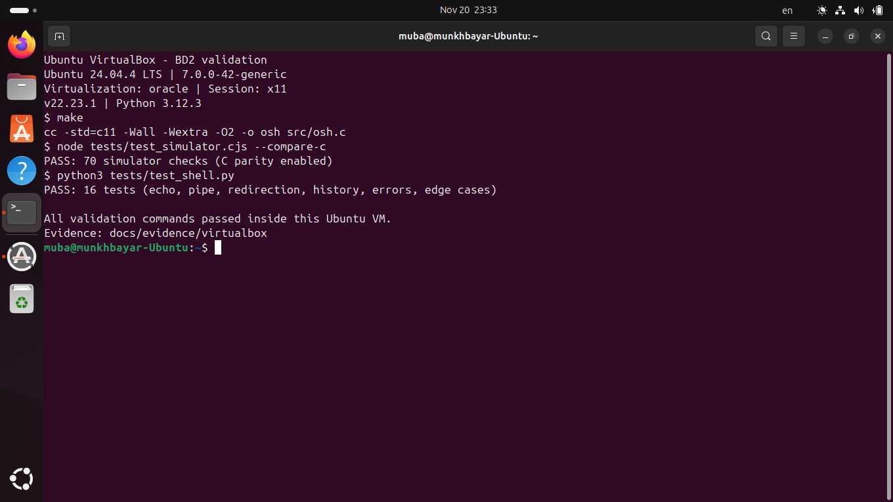
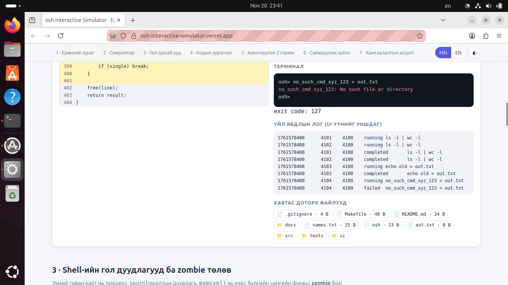

# II-4-1 — UNIX Shell Explorer

**Үйлдлийн систем (F.CSM302) · Бие даалт 1 · 2026–2027 оны хичээлийн жилийн намар**
ШУТИС, Мэдээлэл холбооны технологийн сургууль · Багш: Г. Ганбат

C хэлээр бичсэн энгийн UNIX shell (`osh`). Хэрэглэгчийн командыг child процесст ажиллуулж, history, background, оролт/гаралтын чиглүүлэлт, pipe-ийг дэмжинэ. Нэмэлтээр Python локал сервер болон веб интерфэйсээр команд ажиллуулж, parent/child процессуудыг PID, төлөвийн хамт **Process Tree** хэлбэрээр харуулна.

Даалгавар нь *Operating System Concepts* (10-р хэвлэл) номын 3-р бүлгийн **Programming Project 1 — UNIX Shell** дээр суурилсан.

| Материал | Холбоос |
|---|---|
| Эцсийн тайлан | [docs/II-4-1_BD1_Report.pdf](docs/II-4-1_BD1_Report.pdf) |
| Хэрэглэгчийн гарын авлага | [docs/II-4-1_Manual.pdf](docs/II-4-1_Manual.pdf) |
| БД2 гарын авлага | [docs/II-4-1_Manual_BD2.pdf](docs/II-4-1_Manual_BD2.pdf) |
| Интерактив тайлбар (БД2) | [Симулятор нээх — Vercel](https://osh-interactive-simulator.vercel.app/)|
| Одоогийн C тест | 21 шалгалт (`make test`), background HTTP тестийг тусад нь ажиллуулна |

Өмнөх хувилбарын БД2 туршилтыг **Ubuntu 24.04.4 LTS (VirtualBox)** дээр хийсэн: 70 simulator/C parity шалгалт, 16 C shell тест PASS. Эдгээр лог, зураг нь сүүлийн C засварын баталгаа биш. [Орчин ба лог](docs/evidence/virtualbox/environment.json) · [Screenshot-ууд](docs/screenshots/virtualbox/).





---

## Агуулга

1. [Суулгах ба ажиллуулах](#суулгах-ба-ажиллуулах)
2. [Боломжууд](#боломжууд)
3. [Хэрэглээ](#хэрэглээ)
4. [Веб интерфэйс (UNIX Shell Explorer)](#веб-интерфэйс-unix-shell-explorer)
5. [Тайлбар гарын авлага](#хэрхэн-ажилладаг-вэ)
6. [Тест](#тест)
7. [Алдааны мэдээлэл](#алдааны-мэдээлэл)
8. [Хязгаарлалт](#хязгаарлалт)
9. [Төслийн бүтэц](#төслийн-бүтэц)
10. [Багийн гишүүд](#багийн-гишүүд)

---

## Суулгах ба ажиллуулах

**Шаардлага:** Linux эсвэл macOS, C11 дэмждэг `cc`/`gcc`/`clang`, `make`, Python 3, Git.
Windows дээр шууд ажиллахгүй — **WSL** эсвэл Linux виртуал машин ашиглана.

```bash
# Ubuntu дээр хэрэгслүүдийг суулгах (шаардлагатай бол)
sudo apt update
sudo apt install -y build-essential git python3

# Татах, build хийх, ажиллуулах
git clone https://github.com/bulgaa777/II-4-1-UNIX-Shell.git
cd II-4-1-UNIX-Shell
make          # osh гэсэн ажиллах файл үүснэ
./osh         # shell-ийг эхлүүлнэ
```

Ажиллаж эхлэхэд дараах prompt гарна. Гарахдаа `exit` гэж бичнэ.

```text
osh>
```

---

## Боломжууд

| Боломж | Жишээ | Ашигласан системийн дуудлага |
|---|---|---|
| Команд child процесст ажиллуулах | `ls -l` | `fork()`, `execvp()`, `waitpid()` |
| Background горим | `sleep 5 &` | `fork()` — parent хүлээхгүй |
| Өмнөх командыг давтах | `!!` | — (сүүлийн командыг санах ойд хадгална) |
| Гаралтыг файл руу чиглүүлэх | `ls > out.txt` | `open()`, `dup2()` |
| Оролтыг файлаас унших | `sort < out.txt` | `open()`, `dup2()` |
| Хоёр командыг pipe-аар холбох | `ls -l \| wc -l` | `pipe()`, `dup2()` |
| Хашилттай аргумент | `echo "Hello OS"` | — |
| Хашилттай болон escape хийсэн оператор | `echo "\|"`, `echo \>` | Тэмдэгтийг аргумент гэж танина |
| Shell-ээс гарах | `exit` | — |
| Процессын үйл явдлыг бүртгэх | `OSH_EVENTS=log.tsv ./osh` | PID, PPID, төлөвийг файлд бичнэ |

---

## Хэрэглээ

### Интерактив горим

```text
$ ./osh
osh> echo "Hello Linux Mint" > test.txt
osh> cat < test.txt
Hello Linux Mint
osh> ls -l | grep osh
-rwxrwxr-x 1 vod vod 21632 Oct 28 01:44 osh
-rw-rw-r-- 1 vod vod  9354 Oct 28 01:38 osh.c
osh> sleep 5 &
[background] PID 7972
osh> !!
sleep 5 &
[background] PID 7977
osh> exit
```

*(Linux Mint дээр хийсэн бодит туршилт — [tests/Linux Mint test](<tests/Linux Mint test>))*

### Нэг команд ажиллуулах (`-c`)

Prompt гаргалгүйгээр ганц команд ажиллуулаад exit code-оо буцаана. Автомат тест болон веб сервер энэ горимыг ашигладаг.

```bash
./osh -c "echo hello | wc -c"     # 6
```

### Процессын үйл явдлыг бүртгэх (`OSH_EVENTS`)

`OSH_EVENTS` орчны хувьсагчид файлын нэр өгвөл `osh` child процесс бүрийг таб-аар тусгаарласан мөр болгон бичнэ:

```text
<цаг>   <PID>   <PPID>   <төлөв>   <команд>
```

```bash
export OSH_EVENTS="shell_events.log"
./osh
```

Веб интерфэйсийн Process Tree энэ бүртгэлээс бүтээгддэг.

### Командын жишээ ба хүлээгдэх үр дүн

| Команд | Үр дүн |
|---|---|
| `pwd` | Одоогийн хавтсыг хэвлэнэ |
| `echo Hello UNIX Shell \| wc -w` | `3` |
| `echo Hello UNIX Shell > output.txt` | Файлд текст бичнэ |
| `cat < output.txt` | `Hello UNIX Shell` |
| `sleep 3 &` | `[background] PID ...` хэвлээд shell шууд буцна |
| `!!` | Өмнөх командыг хэвлээд дахин ажиллуулна |
| `echo ">"` | `>` тэмдэгтийг хэвлэнэ; файл руу чиглүүлэхгүй |
| `echo \&` | `&` тэмдэгтийг хэвлэнэ; background болохгүй |

Хоосон болон зөвхөн зайтай мөр history-г солихгүй. `echo FIRST`, зайтай мөр, `!!` гэж оруулбал `FIRST` дахин хэвлэгдэнэ. `  exit` зэрэг эхлэл, төгсгөлдөө зайтай командын гаднах зайг арилгана.

---

## Веб интерфэйс (UNIX Shell Explorer)

```bash
make                     # osh build хийгдсэн байх ёстой
python3 ui/server.py     # Open http://127.0.0.1:8765
```

Браузерт **http://127.0.0.1:8765** хаягаар орно. Серверийг зогсоохдоо `Ctrl + C`.

`sleep 7 &` зэрэг background командын HTTP хариу child дуусахыг хүлээлгүй буцна. Сервер stdout/stderr-ийг түр файлд авч, хариу өгөх үеийн гаралтыг буцаана; background процессын дараах гаралтыг шууд дамжуулахгүй.

| Хэсэг | Тайлбар |
|---|---|
| **Terminal** | Команд оруулж **Run** дарна; stdout, stderr, exit code харагдана |
| **Process Tree** | `osh` parent ба child процессуудын бодит PID, төлөв (`running`, `completed`, `failed`, `finished`) |
| **Command History** | Вебээс ажиллуулсан командуудын жагсаалт |
| **Reset view** | Харагдаж буй үйл явдлыг цэвэрлэнэ (процессыг зогсоохгүй) |

> **Анхааруулга:** Сервер таны компьютер дээр **бодит shell команд** ажиллуулдаг. Зөвхөн өөрийн итгэлтэй локал орчинд ашиглаж, интернетэд нээлттэй байрлуулж болохгүй.

---

## Хэрхэн ажилладаг вэ

Shell нь **Read → Eval → Print** давталтаар ажиллана:

1. **Read** — `osh>` prompt хэвлээд нэг мөр уншина.
2. **Eval** — мөрийг токенд хуваана (`|`, `<`, `>`, `&`, хашилт); `fork()` хийж, child дотор шаардлагатай бол `dup2()`-оор оролт/гаралтыг солиод `execvp()`-ээр командыг ажиллуулна.
3. **Print / Wait** — `&` байхгүй бол parent `waitpid()`-ээр хүлээгээд exit status авна; `&` байвал PID-г хэвлээд шууд дараагийн командыг хүлээнэ. Дууссан background процессуудыг давталт бүрийн эхэнд цуглуулна. `getline()` оролт хүлээж байвал дараагийн оролт иртэл zombie түр үлдэж болно.

```text
            ┌────────────── osh (parent) ──────────────┐
            │  pipe(fds)                               │
            │  fork() ─────────────┐  fork() ──────┐   │
            └──────────────────────┼───────────────┼───┘
                                   ▼               ▼
                         child 1: ls -l    child 2: wc -l
                         stdout → fds[1]   stdin ← fds[0]
```

Алхам алхмаар тайлбарыг [БД2 симулятороос](https://osh-interactive-simulator.vercel.app/) үзнэ. MINOR-03, SUGGESTION-02-ийн засвар, гар туршилт, screenshot, CI нотолгоог [тусдаа repository](https://github.com/mubabne/osh-interactive-simulator)-д хадгалсан (private; үзэхэд эрх хэрэгтэй). Локал хувилбар нь `Interactive/osh_HowItWorks.html`.

Симуляторын тест: `node tests/test_simulator.cjs` (Node.js 20+). Linux/macOS/WSL дээр C кодтой харьцуулах команд нь `node tests/test_simulator.cjs --compare-c`. [Гар туршилтын заавар](docs/Interactive_Testing.md).

**Одоогийн зөрүү:** `Interactive/osh_HowItWorks.html` доторх C код нь шинэ `src/osh.c`-тэй таарахгүй тул тест эхний `embedded C source matches src/osh.c` шалгалт дээр унана. Симуляторын загвар, тест нь quoted operator болон зайтай мөрийн хуучин дүрэмтэй хэвээр. Embedded код, загвар, тестийг хамт шинэчлэх хүртэл одоогийн C кодтой parity баталгаажаагүй. Энэ локал зөрүү нь тусдаа Vercel deployment-ийн шинэчлэлтийг шалгасан гэсэн үг биш.

---

## Тест

```bash
make test
```

Амжилттай бол:

```text
python3 tests/test_shell.py
PASS: 21 tests (echo, pipe, redirection, history, quoted operators, whitespace, errors, edge cases)
```

[tests/test_shell.py](tests/test_shell.py) нь `./osh -c ...` хэлбэрээр командуудыг ажиллуулж гаралт, stderr, exit code-г шалгана. Аль нэг шалгалт унавал `AssertionError: <тестийн нэр>` гарна.

| № | Тест | Шалгах зүйл | № | Тест | Шалгах зүйл |
|---|---|---|---|---|---|
| 1 | echo | Энгийн командын гаралт | 9 | invalid command | Байхгүй командын алдаа |
| 2 | pipe | `echo hello \| wc -c` → `6` | 10 | empty input | Хоосон оролт дээр унахгүй |
| 3 | output redirect | Файлд гаралт бичих | 11 | whitespace input | Зөвхөн зайтай оролт |
| 4 | input redirect | Файлаас оролт унших | 12 | missing file message | stderr-д алдааны мэдээлэл |
| 5 | empty history | Түүх хоосон үед `!!` | 13 | redirect without filename | `ls >` |
| 6 | invalid pipe | `echo hi \|` | 14 | pipe without left command | `\| wc -c` |
| 7 | missing file | Байхгүй файлаас унших | 15 | redirect to bad path | Байхгүй хавтсанд бичих |
| 8 | history replay | `!!` өмнөх командыг давтах | 16 | blank lines then exit | Хоосон мөр, дараа нь `exit` |

Тест 1–8 нь үндсэн боломжууд, 9–16 нь алдаа болон захын нөхцөлүүд. Нэмсэн 17–20 нь `echo "|"`, `echo ">"`, `echo "&"`, `echo \|`-ийн гаралтыг шалгана. 21 дэх нь зайтай мөрийн дараах `!!` өмнөх командыг давтах, `  exit` shell-ээс гарахыг шалгана.

Background HTTP тестийг тусад нь ажиллуулна (`make test`-д ороогүй):

```bash
make
python3 tests/test_background_ui.py
```

Тест өөрөө локал серверийг 8765 порт дээр асааж, `sleep 7 &` командын хариу 3 секундээс өмнө ирэх, exit code 0, `[background] PID` гарахыг шалгаад серверийг зогсооно. Өмнө асаасан UI сервер байвал эхлээд зогсооно. Амжилттай бол `PASS: background HTTP test (...)` гарна.

Хадгалсан Ubuntu (VirtualBox), Linux Mint, macOS үр дүн нь өмнөх **16 тестийн** хувилбарынх. Шинэ 21 C тест болон HTTP тестийг энэ README шинэчлэх үеэр Windows дээр дахин ажиллуулаагүй.

---

## Алдааны мэдээлэл

| Нөхцөл | Мэдээлэл |
|---|---|
| Түүх хоосон үед `!!` | `No commands in history.` |
| Pipe-ийн аль нэг тал хоосон, эсвэл 2-оос олон pipe | `Invalid pipe` |
| `<` / `>`-ийн дараа файлын нэр байхгүй | `Missing redirection filename` |
| `<` эсвэл `>` давхардсан | `Duplicate redirection` |
| `&` төгсгөлд биш | `& must be last` |
| Хашилт хаагдаагүй | `Unclosed quote` |
| Команд олдоогүй | `<команд>: No such file or directory` (exit code 127) |
| Оролтын файл олдоогүй | `<файл>: No such file or directory` |

### Түгээмэл асуудал

| Асуудал | Шийдэл |
|---|---|
| `./osh: No such file or directory` | Эхлээд `make` ажиллуулж, зөв хавтсанд байгаа эсэхээ шалгана |
| `make: command not found` | `build-essential` (Ubuntu) эсвэл Command Line Tools (macOS) суулгана |
| `Address already in use` | 8765 порт дээр өмнө асаасан серверийг зогсооно |
| Windows дээр ажиллахгүй | WSL эсвэл Linux VM ашиглана |
| Background төлөв `running` хэвээр | Хэдэн секунд хүлээгээд дахин шалгана |

---

## Хязгаарлалт

- Зөвхөн **нэг pipe** (хоёр команд) дэмжинэ.
- `$VAR`, `*`, `~` зэрэг shell expansion болон `cd`, `jobs`, `fg` зэрэг built-in команд, job control байхгүй.
- History нь зөвхөн **сүүлийн нэг командыг** хадгална (`!!`).
- Веб UI-д команд бүр шинэ `osh` процесс үүсгэдэг тул нэг тасралтгүй shell session биш.
- Process Tree нь kernel-ээс шууд уншсан бус, `osh`-ийн бичсэн event log дээр суурилсан. `finished` гэдэг нь процесс дууссаныг илэрхийлэх ба exit code 0 гэсэн баталгаа биш.
- Тест давсан нь зөвхөн хамрагдсан нөхцөлүүдийн зөв ажиллагааг харуулна.
- Локал симулятор шинэ C засвартай хараахан нийцээгүй; дээрх parity зөрүүг харна.

---

## Төслийн бүтэц

```text
II-4-1-UNIX-Shell/
├── src/osh.c                     Shell-ийн эх код (C11)
├── Makefile                      make / make test / make clean
├── tests/
│   ├── test_shell.py             21 C shell тест
│   ├── test_background_ui.py     Background HTTP хариуны тест
│   ├── test_simulator.cjs        Симулятор ба C parity шалгалт
│   └── Linux Mint test           Linux Mint дээрх гар туршилтын лог
├── ui/
│   ├── server.py                 Python локал сервер (127.0.0.1:8765)
│   └── index.html                Веб интерфэйс (Terminal, Process Tree, History)
├── Interactive/
│   └── osh_HowItWorks.html       Интерактив сургалтын хуудас (GitHub Pages)
└── docs/
    ├── II-4-1_BD1_Report.pdf     Эцсийн тайлан
    ├── II-4-1_Manual.pdf         Хэрэглэгчийн гарын авлага
    ├── II-4-1_Manual_BD2.pdf     БД2 гарын авлага
    ├── Interactive_Testing.md    Симуляторын гар туршилт
    ├── REVIEW_RESPONSES.md       Review хариу ба өмнөх нотолгоо
    ├── evidence/                Туршилтын лог, орчны мэдээлэл
    ├── screenshots/             Туршилтын зургууд
    └── Report_Draft_v1.pdf       Тайлангийн эхний хувилбар
```

| Make команд | Үйлдэл |
|---|---|
| `make` | `src/osh.c`-ийг `osh` болгон compile хийнэ (`-std=c11 -Wall -Wextra -O2`) |
| `make test` | Build хийгээд 21 C shell тестийг ажиллуулна |
| `make clean` | `osh` файлыг устгана |

---

## Багийн гишүүд

| Гишүүн | Оюутны код | Хариуцсан ажил |
|---|---|---|
| Д. Булгантуяа | B231940067 | Shell-ийн үндсэн функцүүд, Python сервер, Web UI, Process Tree; macOS дээрх туршилт, багийн зохион байгуулалт, GitHub Pages |
| Л. Ариунзаяа | B241940061 | Тайлангийн эхний хувилбар: онол, системийн дуудлага, архитектур, өгөгдлийн урсгал |
| У. Янжинлхам | B242270131 | Туршилтын аргачлал, тестийн үр дүн, дүгнэлт; эцсийн тайланг нэгтгэн эцэслэсэн |
| Ч. Мөнхбаяр | B242270045 | Интерактив симулятор, процессын архитектурын дүрслэл, README |
| Б. Энхбаяр | B180930028 | 8 нэмэлт тест (нийт 16), Ubuntu VirtualBox дээрх баталгаажуулалт |
| Т. Цэгц | B241910015 | Хэрэглэгчийн гарын авлага, Linux Mint дээрх туршилт |
---

## Ашигласан хэрэгсэл ба эх сурвалж

- C (C11), POSIX системийн сангууд — гадны сан ашиглаагүй
- Python 3 (`http.server`, `subprocess`) — веб сервер ба тест
- Git, GitHub, GitHub Pages
- A. Silberschatz, P. B. Galvin, G. Gagne. *Operating System Concepts*, 10th ed. Wiley, 2018 — Chapter 3, Programming Project 1
